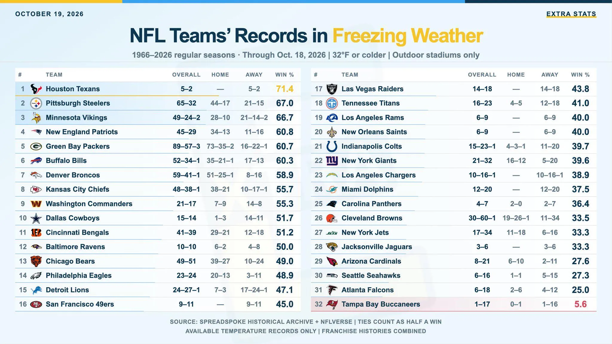

¿Cómo rinden los Dolphins cuando juegan a 0 °C o menos?

Desde 1966, Miami acumula 12 victorias y 20 derrotas (37,5 %), ocupando el 24.º puesto de la NFL.

AFC East:
Bills: 60,3 %
Patriots: 60,8 %
Dolphins: 37,5 %
Jets: 33,3 %

Datos de partidos al aire libre.

