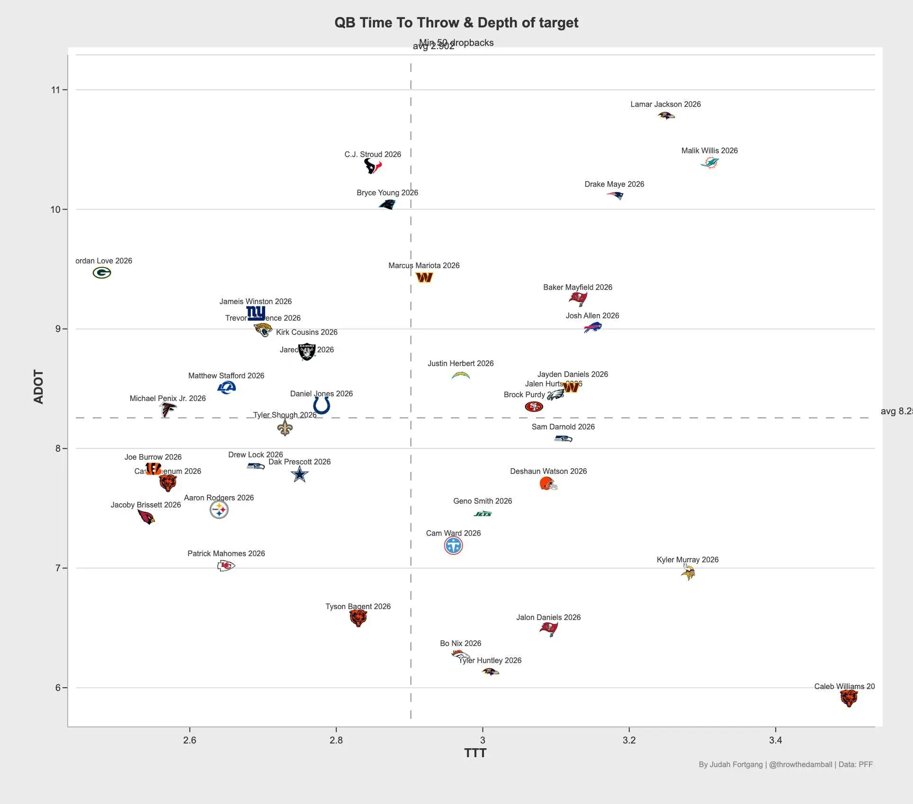

Malik Willis destaca en dos estadísticas tras la semana 6:
º QB con mayor tiempo medio hasta el lanzamiento (~3,3 segundos).
º en profundidad media de los pases intentados (~10,4 yardas).
Miami está apostando por un juego aéreo que busca objetivos profundos.
Vía PFF | Judah Fortgang

