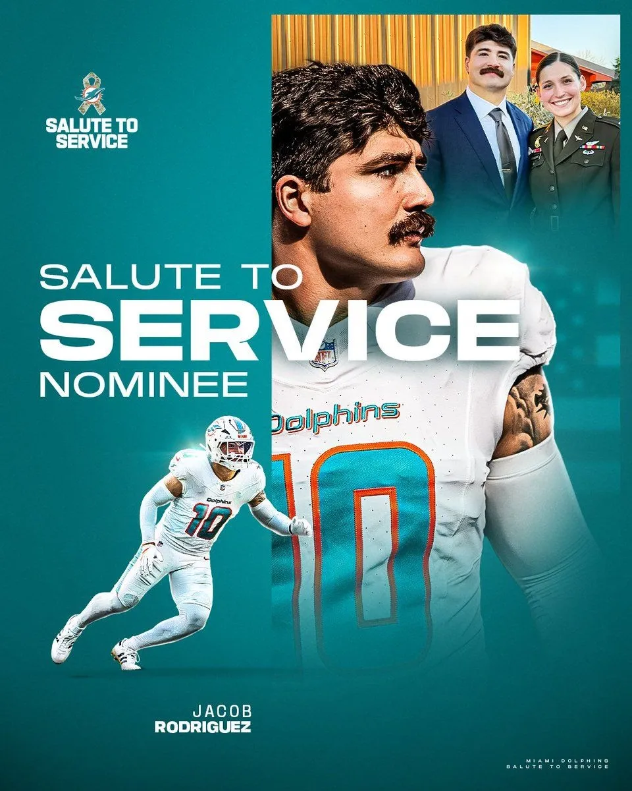

Jacob Rodriguez ha sido elegido por Miami como candidato al premio Salute to Service 2026 de la NFL, que reconoce el apoyo a militares y sus familias.
Su padre es veterano del Ejército estadounidense y su esposa, Emma, es piloto de helicópteros Black Hawk en activo. [nfl.com/SaluteFanVote](https://nfl.com/SaluteFanVote)

